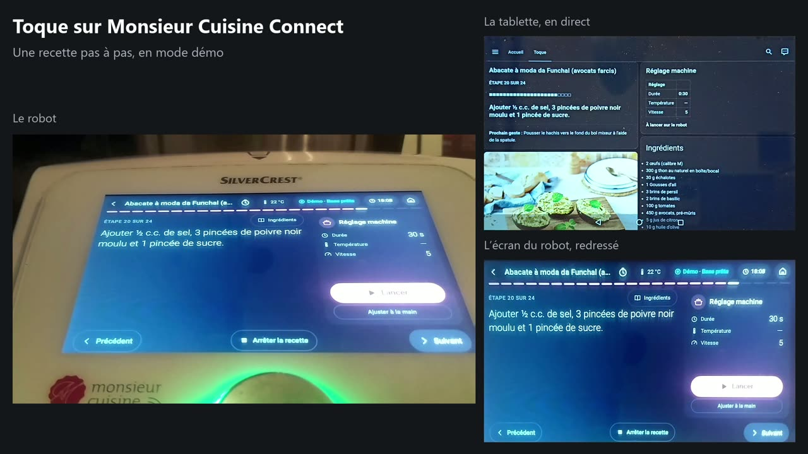

# Video: a guided recipe followed in Home Assistant

**[Download the video](https://github.com/McSoda/MrCuisineVibeConnect/releases/download/v0.10.0.1/video-toque-home-assistant.mp4)**
(MP4, 4 min 08 s, 1080p, 107 MB). On-screen text is in French.

## What it shows

A full 24-step recipe on a Monsieur Cuisine Connect, with three views side by side: the robot, the robot's screen
straightened, and a wall tablet showing a Home Assistant dashboard that follows the recipe live.

On the tablet: recipe title and picture, ingredients, current step and progress, next manual action, machine setting of
the step, weighing, and, while a program runs, the remaining time, the expected end and the measurements.

| Time | Moment |
|---|---|
| 0:00 | Home screen, the recipe is chosen |
| 0:26 | The tablet wakes up and switches to the cooking view |
| 2:05 | A Turbo step |
| 3:30 | A 30 s program, with the countdown on both screens |
| 4:00 | "Bon appétit", end of the recipe |

## What to know

- Recorded in **demo mode**: no motor, no heating. Temperature and weight are not real measurements.
- The home dashboard seen for a couple of seconds when the tablet wakes up is blurred on purpose.
- This uses **this fork** ([release 0.10.0.1](https://github.com/McSoda/MrCuisineVibeConnect/releases/tag/v0.10.0.1)),
  its read-only [local API](HOME_ASSISTANT_API.md) and the
  [McSoda/toque-homeassistant](https://github.com/McSoda/toque-homeassistant) integration. It does **not** use the
  Toque Compagnon API of the upstream project.
- The dashboard is a personal one built with standard Markdown and picture cards. It is not shipped with the
  integration.
